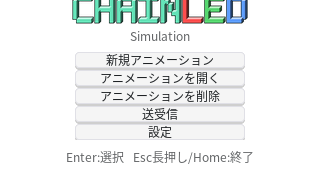
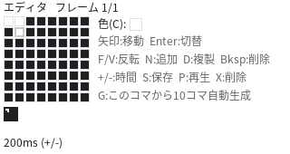
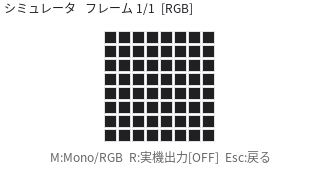
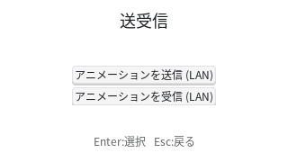
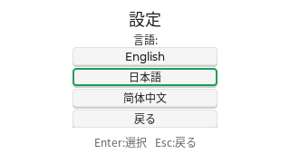
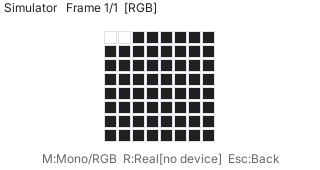

# Chain LED Simulation for CardputerZero

[M5Stack CardputerZero](https://cardputerzero.github.io/)（320×170、LVGL v9.5 + C++/CMake）向けの、ドットアニメーション作成・LEDマトリクスシミュレータです。

- **作成**: キーボード操作のみで8×8ドットアニメーション（最大10コマ）を作成。コマごとの表示時間設定、反転/複製などのコマ編集機能付き。
- **自動生成**: 1枚目のコマを描くと、`ProceduralCompleter`が決定的なパターン変換で残りのコマを自動生成（ローカルLLMによる生成も検証したが、RAM容量の都合で不採用——詳細は[アーキテクチャ](#アーキテクチャ)参照）。
- **シミュレーション＆実機出力**: 画面上でRGB/Monoモードのプレビュー再生ができるほか、同じアニメーションを実際のChain Mono / Chain RGB（M5Stack Chainシリーズ）8×8 LEDマトリクスにUART経由でリアルタイム出力。
- **配布**: 2台のCardputerZero間で**BLE**（デフォルト、実機向け経路）または**TCP/LAN**（デスクトップ開発用経路）を使ってアニメーションを送受信。
- **対応言語**: English / 日本語 / 简体中文 — 設定画面からいつでも切り替え可能（再起動不要）。

English README is available at [README.md](README.md).

## スクリーンショット

| タイトル | エディタ | シミュレータ |
| --- | --- | --- |
|  |  |  |

| 送受信 | 設定 | 実機出力 |
| --- | --- | --- |
|  |  |  |

日本語・簡体字中国語 UI を含む追加のスクリーンショットは [`docs/screenshots/`](docs/screenshots/)（`*_ja.png` / `*_zh.png` ファイル）にあります。

## キー操作

| 画面 | キー | 動作 |
| --- | --- | --- |
| タイトル | 矢印キー / Enter | フォーカス移動 / メニュー項目の選択 |
| タイトル | Esc（長押し、約1秒）または Home | どの画面からでも安全に終了 |
| エディタ | 矢印キー / Enter | ピクセルカーソルの移動 / カーソル位置のピクセル切替 |
| エディタ | `C` | 描画色を切り替え |
| エディタ | `F` / `V` | 現在のコマを左右 / 上下反転 |
| エディタ | `N` / `D` / Backspace | コマ追加 / 現在のコマを複製 / 現在のコマを削除 |
| エディタ | `,` / `.` | 前 / 次のコマへ移動 |
| エディタ | `+` / `-` | 現在のコマの表示時間を調整 |
| エディタ | `G` | このコマから残りのコマを自動生成（`ProceduralCompleter`） |
| エディタ | `S` / `X` | アニメーションを保存 / 保存ファイルを削除 |
| エディタ | `P` | シミュレータでプレビュー |
| シミュレータ | `M` | RGB / Mono プレビューを切替 |
| シミュレータ | `R` | 実際のChain Mono/RGBユニットへのライブ出力を切替 |
| 全画面共通 | Esc（短押し） | 1階層戻る |

## 開発者向け情報

### ビルド方法（macOS デスクトップ）

Homebrew で依存関係をインストール:

```shell
brew install cmake ninja libpng jpeg fmt sdl2 freetype dpkg zlib
```

Configure・ビルド・テスト（Apple Silicon）:

```shell
cmake --preset darwin-arm64
cmake --build --preset darwin-arm64-dbg
ctest --preset darwin-arm64-dbg
```

デスクトップシミュレータの実行:

```shell
./build/darwin-arm64/Debug/chainled
```

Intel Mac の場合は `darwin-x86-64` の preset を使用してください。CardputerZero クロスビルド／実機向けデバイスビルド（Docker `debian:trixie` での手順を含む）、CMake オプション（`CHAINLED_BLE` / `CHAINLED_WINDOW_ZOOM` 等）、フェーズごとの開発履歴の詳細は [`NOTES.md`](NOTES.md) を参照してください。設計時の方針は [`PLAN.md`](PLAN.md) を参照してください。

### 現在の状況

本プロジェクトは開発途中です（フェーズ計画の全体は [`PLAN.md`](PLAN.md) を参照）。Phase 0〜7（アニメーションコア、エディタ/シミュレータUI、残りコマ自動生成——ローカルLLM経路はRAM容量の都合で不採用と判断済み、詳細は`NOTES.md`「Phase 3: Go/No-Go」参照——、Chain Mono/RGBプロトコル＋実機出力、TCP/BLE配布、EN/JA/ZH多言語対応）は完了済みです。パッケージング（`.deb`化）と実機検証（Phase 8〜9）はまだ未着手のため、現時点ではインストール可能なパッケージやHub AppStoreでの配布はありません。ソースからビルドする（上記参照）のが現状唯一の実行方法です。

### アーキテクチャ

デスクトップ上で実機に触れる前にアプリ全体を開発・検証できるよう、アニメーションロジック・出力デバイス・通信・UI を分離した構成になっています。

```
view/        LVGL v9 の画面・ウィジェット・ピクセルグリッド描画・キー入力処理
i18n/        文字列カタログ（EN/JA/ZH）+ CJKフォント読み込み。LVGL・アニメーションロジックに非依存
core/        純粋な C++ アニメーションロジック — 8x8フレームモデル・直列化・再生タイミング。
             I/O・LVGL・スレッドに非依存
generator/   AnimationGenerator: ProceduralCompleter（1枚のシード画から決定的にコマを自動生成）
             ——LlmCompleterも検証したが不採用となった経緯はNOTES.md参照
chain/       Chain Mono/RGB の UART プロトコル（エンコード/デコード）+ RealChainOutput（POSIX termios）
net/         トランスポート非依存プロトコル（フレーミング、ACK/再送）。TcpTransport（デスクトップ/LAN
             開発用経路）と BleTransport（BlueZ/D-Bus）を共通の ITransport インターフェースの
             背後に実装
```

`core/`・`chain/`・`generator/`・`net/` は LVGL に依存せず、豊富な `ctest` スイート（ヘッドレス。ロス/重複/分断のネットワークソークテストや実ソケット越しの転送テストを含む）でカバーされています。設計時の方針は [`PLAN.md`](PLAN.md)、実際に実装された内容や既知の制約は [`NOTES.md`](NOTES.md) を参照してください。

## ライセンス

本プロジェクトは [MIT License](LICENSE) のもとで公開されています。LVGL・フォント・fmt 等のサードパーティコンポーネントはそれぞれ独自のライセンスに従います — 一覧は [`THIRD_PARTY_LICENSES.md`](THIRD_PARTY_LICENSES.md) を参照してください。
