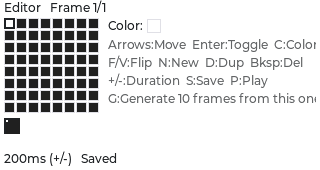
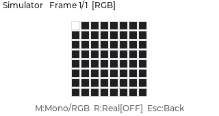

# Chain LED Simulation for CardputerZero

A dot-animation editor and LED-matrix simulator built for the [M5Stack CardputerZero](https://cardputerzero.github.io/) (320×170, LVGL v9.5 + C++/CMake).

- **Create**: draw 8×8 pixel animations (up to 10 frames) with a keyboard-only editor, per-frame duration control, flip/duplicate/undo-style frame ops.
- **Auto-generate**: draw one frame and let `ProceduralCompleter` fill in the rest with deterministic pattern transforms (a local-LLM completer was evaluated and rejected on RAM grounds — see [Architecture](#architecture)).
- **Simulate & drive real hardware**: preview on-screen in RGB or Mono mode, then output the same animation live to a real Chain Mono / Chain RGB (M5Stack Chain series) 8×8 LED matrix over UART.
- **Distribute**: send/receive animations between two CardputerZero units over **BLE** (default, real-device path) or **TCP/LAN** (desktop development path).
- **Languages**: English, 日本語 (Japanese), 简体中文 (Simplified Chinese) — switchable anytime from Settings, no restart required.

日本語版の README は [README.ja.md](README.ja.md) を参照してください。

## Screenshots

| Title | Editor | Simulator |
| --- | --- | --- |
|  |  |  |

| Send / Receive | Settings | Real Chain output |
| --- | --- | --- |
|  |  |  |

More screenshots, including the Japanese and Simplified Chinese UI, are in [`docs/screenshots/`](docs/screenshots/) (see the `*_ja.png` / `*_zh.png` files).

## Key Controls

| Screen | Key | Action |
| --- | --- | --- |
| Title | Arrow keys / Enter | Move focus / select a menu entry |
| Title | Esc (hold, ~1s) or Home | Quit the app safely from anywhere |
| Editor | Arrow keys / Enter | Move the pixel cursor / toggle the pixel under it |
| Editor | `C` | Cycle the draw color |
| Editor | `F` / `V` | Flip the current frame horizontally / vertically |
| Editor | `N` / `D` / Backspace | New frame / duplicate current frame / remove current frame |
| Editor | `,` / `.` | Previous / next frame |
| Editor | `+` / `-` | Adjust the current frame's display duration |
| Editor | `G` | Generate the remaining frames from this one (`ProceduralCompleter`) |
| Editor | `S` / `X` | Save the animation / delete the saved file |
| Editor | `P` | Preview in the Simulator |
| Simulator | `M` | Toggle RGB / Mono preview |
| Simulator | `R` | Toggle live output to a real Chain Mono/RGB unit |
| Any screen | Esc (short press) | Go back one screen |

## Development

### Build (macOS desktop)

Install dependencies with Homebrew:

```shell
brew install cmake ninja libpng jpeg fmt sdl2 freetype dpkg zlib
```

Configure, build, and test (Apple Silicon):

```shell
cmake --preset darwin-arm64
cmake --build --preset darwin-arm64-dbg
ctest --preset darwin-arm64-dbg
```

Run the desktop simulator:

```shell
./build/darwin-arm64/Debug/chainled
```

For Intel Macs, use the `darwin-x86-64` presets instead. See [`NOTES.md`](NOTES.md) for the CardputerZero cross-build/device build (including the Docker `debian:trixie` device-build runbook), CMake options (`CHAINLED_BLE`, `CHAINLED_WINDOW_ZOOM`, etc.), and the full phase-by-phase development history. [`PLAN.md`](PLAN.md) has the original design rationale.

### Status

This project is under active development (see [`PLAN.md`](PLAN.md) for the full phase plan). Phases 0–7 are complete: animation core, editor/simulator UI, procedural frame generation (with a local-LLM path evaluated and rejected — RAM budget, see `NOTES.md` "Phase 3: Go/No-Go"), Chain Mono/RGB protocol + device output, TCP and BLE distribution, and EN/JA/ZH localization. Packaging (`.deb`) and real-hardware validation (Phase 8–9) have not started yet — there is no installable package or Hub AppStore listing at this time; building from source (above) is the only way to run it.

### Architecture

The codebase separates animation logic, device output, networking, and UI so the whole app can be developed and tested on desktop before ever touching real hardware:

```
view/        LVGL v9 screens, widgets, pixel-grid rendering, key input handling
i18n/        String catalog (EN/JA/ZH) + CJK font loading, no LVGL/animation-logic dependency
core/        Pure C++ animation logic — 8x8 frame model, (de)serialization, playback timing.
             No I/O, no LVGL, no threads.
generator/   AnimationGenerator: ProceduralCompleter (deterministic frame completion from a
             single seed frame) -- an LlmCompleter was evaluated and rejected, see NOTES.md
chain/       Chain Mono/RGB UART protocol (encode/decode) + RealChainOutput (POSIX termios)
net/         Transport-agnostic protocol (framing, ACK/retry) with TcpTransport (desktop/LAN
             dev path) and BleTransport (BlueZ/D-Bus) implementations behind one ITransport
             interface
```

`core/`, `chain/`, `generator/`, and `net/` have no LVGL dependency and are covered by an extensive `ctest` suite (headless, including a lossy/duplicating/fragmenting network soak test and real-socket transfer tests). See [`PLAN.md`](PLAN.md) for the original design rationale and [`NOTES.md`](NOTES.md) for what actually got built, including known limitations.

## License

This project is released under the [MIT License](LICENSE). Third-party components (LVGL, fonts, fmt, etc.) are under their own licenses — see [`THIRD_PARTY_LICENSES.md`](THIRD_PARTY_LICENSES.md) for the full list.
